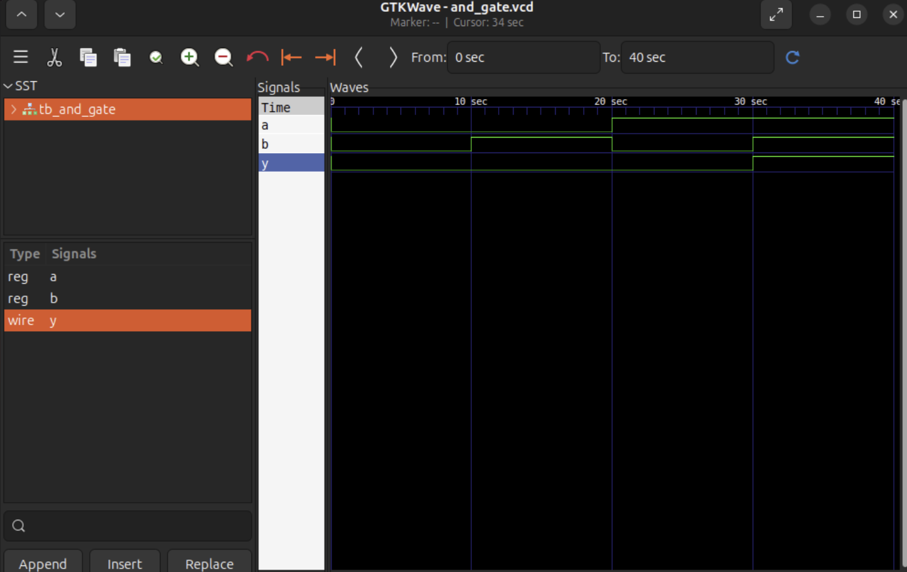

# AND Gate - Verilog RTL Design

## 1. Objective
Design and verify a 2-input AND gate using Verilog HDL.

## 2. Tools Used
- Ubuntu Linux
- Visual Studio Code
- Icarus Verilog 12.0
- GTKWave 3.3.126

## 3. Design Description
An AND gate produces output HIGH (1) only when
both inputs are HIGH (1).

## 4. Truth Table

| A | B | Y |
|---|---|---|
| 0 | 0 | 0 |
| 0 | 1 | 0 |
| 1 | 0 | 0 |
| 1 | 1 | 1 |

## 5. Verification
- Created a Verilog testbench.
- Tested all four input combinations.
- All four test cases passed.
- Observed waveforms using GTKWave.

## 6. Learning Outcomes
- Verilog module structure
- Continuous assignment
- Testbench development
- RTL compilation and simulation
- Waveform analysis

  ## 7. Simulation Waveform

